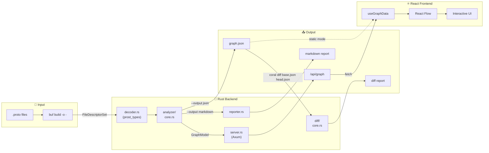

# 🪸 Coral

Proto dependency visualizer for gRPC/Connect projects with a Neon-style interactive Web UI.

[](https://github.com/daisuke8000/coral/actions/workflows/ci.yml)

**[Live Demo](https://daisuke8000.github.io/coral/)**

## Features

- **Interactive Visualization**: React Flow-based graph with zoom, pan, and explore
- **Neon Aesthetics**: Dark mode with glow effects and animated data flow
- **Package Grouping**: Expand/collapse packages and search/filter their visibility
- **Auto Layout**: Load Dagre on demand, with animated layout/camera transitions and explicit Motion off/reduced-motion support
- **Proto Diff**: Compare two proto snapshots and detect added/modified/removed definitions
- **Markdown Reports**: Generate detailed Markdown output for PR comments
- **Pipeline-Friendly**: `buf build -o - | coral serve` workflow
- **GitHub Action**: Automate proto analysis in your CI/CD pipeline
- **GitHub Pages**: Deploy interactive documentation for your proto files

## Quick Start

### CLI Usage

Building the current source requires a current stable Rust toolchain (edition 2024), Node.js 26 with npm for the UI, and the Buf CLI to compile `.proto` files. The CLI reads a binary `FileDescriptorSet`, not proto source text. Development instructions describe current source; Action examples below intentionally pin the published v0.2.2 release, not Unreleased changes.

```bash
# Build from source
git clone https://github.com/daisuke8000/coral.git
cd coral
cargo build --release --locked
export PATH="$PWD/target/release:$PATH"

# Build the frontend separately; it is not embedded in the binary
(cd ui && npm ci && npm run build)
CORAL_UI="$PWD/ui/dist"

# Visualize a project with a buf.yaml configuration
cd /path/to/your-proto-project
buf build -o - | coral serve --static-dir "$CORAL_UI"
# Open http://localhost:3000

# Output as JSON
buf build -o - | coral --output json > graph.json

# Output as Markdown report
buf build -o - | coral --output markdown

# Compare two proto snapshots (diff)
coral diff base.json head.json
```

`coral` defaults to `--output json`; `-o` also accepts `debug`, `summary`, and `markdown`. Summary counts all services and only top-level message/enum declarations; debug lists per-file descriptor counts. Neither is a graph-node count. Input is limited to 256 MiB while reading. `coral diff` requires two UTF-8 `.json` graph snapshots, each at most 32 MiB, and always prints a Markdown diff.

Without `--static-dir`, `coral serve` exposes only `/api/graph` and `/health`. It binds to `127.0.0.1`, defaults to port 3000 (`-p`/`--port`), and stops gracefully on Ctrl+C. The local API is unauthenticated. Cross-origin access is limited to HTTP localhost/127.0.0.1 origins on ports 3000 and 5173; static files can be served from the same origin on the chosen port.

### GitHub Action

Add Coral to your workflow to automatically analyze proto dependencies on every PR:

```yaml
# .github/workflows/proto-analysis.yml
name: Proto Analysis

on:
  pull_request:
    paths:
      - 'proto/**'

jobs:
  analyze:
    runs-on: ubuntu-latest
    permissions:
      contents: read
      pull-requests: write

    steps:
      - uses: actions/checkout@3d3c42e5aac5ba805825da76410c181273ba90b1 # v7.0.1

      - name: Analyze Proto Dependencies
        uses: daisuke8000/coral@075547e635b80ba6ac5a2396d3bbfa369b9c1e1a # v0.2.2
        with:
          proto-path: 'proto'
          version: 'v0.2.2'
          comment-on-pr: 'true'
          github-token: ${{ secrets.GITHUB_TOKEN }}
```

> **Note**: When using `comment-on-pr: 'true'` on public repositories, proto schema structure (message names, field names, service definitions) will be visible in PR comments. Consider this if your proto files contain internal API specifications.

## GitHub Action Inputs

| Input | Description | Default |
|-------|-------------|---------|
| `proto-path` | Path to proto files directory (must be within the workspace) | `proto` |
| `buf-config` | Path to buf.yaml configuration file (relative to proto-path) | `''` |
| `comment-on-pr` | Post a diff-only comment on pull requests | `false` |
| `github-token` | GitHub token for PR comments (requires `pull-requests: write`) | `''` (falls back to `github.token`) |
| `generate-pages` | Generate static HTML for GitHub Pages | `false` |
| `version` | Coral version to download (e.g. `v0.2.2`, defaults to the action ref tag) | `''` |

Use the Ubuntu runner shown in the examples; the current Action's path validation uses GNU `realpath`. `proto-path` must resolve to an existing directory inside the workspace, and `buf-config`, when set, must be a relative path resolving to a file inside that directory. Symlinks are checked after resolution; paths containing carriage returns/newlines are rejected. For PR diffs, the original paths are checked again after the base checkout and the original branch/detached HEAD is restored, including on failure.

The Action checks downloaded binary checksums and falls back to building source when a binary/checksum is unavailable. A checksum mismatch fails the run. When pinning the Action by commit SHA, set `version` explicitly to use a matching release binary; otherwise the SHA is used as the release ref and normally triggers the source-build fallback. Keep the Action revision and binary version aligned.

## GitHub Action Outputs

| Output | Description |
|--------|-------------|
| `json-path` | Path to the generated JSON file |
| `html-path` | Path to the generated HTML directory (if generate-pages is true) |
| `markdown-report` | Detailed markdown report of proto dependencies |
| `diff-report` | Diff report showing changes from base branch |

The current Action builds the head descriptor once for JSON and Markdown. `json-path` is `coral-output/graph.json`; optional `html-path` is `coral-output/html`. Full analysis remains in `markdown-report`, while PR comments use only `diff-report` and update an existing Coral bot comment when found. Artifacts contain `coral-output` and are retained for one day; Pages generation does not itself deploy the site.

## Deploy to GitHub Pages

Deploy an interactive visualization of your proto dependencies:

```yaml
# .github/workflows/pages.yml
name: Deploy Proto Docs

on:
  push:
    branches: [main]
    paths:
      - 'proto/**'

permissions:
  contents: read
  pages: write
  id-token: write

jobs:
  build:
    runs-on: ubuntu-latest
    steps:
      - uses: actions/checkout@3d3c42e5aac5ba805825da76410c181273ba90b1 # v7.0.1

      - name: Generate Pages
        uses: daisuke8000/coral@075547e635b80ba6ac5a2396d3bbfa369b9c1e1a # v0.2.2
        with:
          proto-path: 'proto'
          version: 'v0.2.2'
          generate-pages: 'true'

      - uses: actions/configure-pages@45bfe0192ca1faeb007ade9deae92b16b8254a0d # v6.0.0
      - uses: actions/upload-pages-artifact@7b1f4a764d45c48632c6b24a0339c27f5614fb0b # v4.0.0
        with:
          path: 'coral-output/html'

  deploy:
    runs-on: ubuntu-latest
    needs: build
    environment:
      name: github-pages
      url: ${{ steps.deployment.outputs.page_url }}
    steps:
      - uses: actions/deploy-pages@368f82528645a54fb793d4d04e342629a3f51346 # v5.0.1
        id: deployment
```

## Node Classification

| Type | Condition | Color |
|------|-----------|-------|
| **Service** | Each local `service` definition | Magenta `#ff00ff` |
| **Message** | `message` definitions | Cyan `#00ffff` |
| **Enum** | `enum` definitions | Yellow `#ffcc00` |
| **External** | Referenced message/enum definitions from paths starting with `google/` or `buf/` | Gray `#666666` |

### Supported graph and diff behavior

Nodes represent definitions, not files. Nested messages/enums and synthetic map-entry messages are included with scoped IDs. RPC input/output and message field references form directed, deduplicated edges; references absent from the supplied descriptors are omitted. External classification uses the descriptor file path, not its package name. Only referenced external nodes are shown, including RPC-only references. Service details retain expandable input/output fields and distinguish same-short-name types from different packages.

Diffs compare represented fields, RPC signatures, and enum values. A changed field number/type/label, RPC input/output, enum number, or definition kind is represented as removal plus addition. Field/method reordering is ignored; enum declaration order is significant for implicit defaults and alias precedence. Package/file metadata and graph edges alone do not produce schema modifications.

Coral is not a complete protobuf compatibility checker: streaming flags, oneof grouping, explicit defaults and other options are not represented or compared. Oneof members are displayed as ordinary fields, and maps use their synthetic entry definitions rather than `map<K,V>` notation. Fully qualified descriptor references are expected; relative references and malformed duplicate definitions are not normalized. Iterative analyzer traversal does not silently truncate nested definitions at depth 32; decoding still follows the protobuf decoder's limits.

## Development

```bash
# Rust checks (current stable toolchain with rustfmt and clippy)
cargo fmt -- --check
cargo clippy --all-targets --locked -- -D warnings
cargo test --locked
cargo build --release --locked

# Run with sample protos
(cd sandbox && buf build -o - | ../target/release/coral --output summary)
```

`make build`, `make test`, and `make check` cover Rust only. `make dev` also installs/builds UI dependencies and serves the sandbox graph; the commands below keep frontend checks explicit and use the committed npm lockfile. The frontend CI/build runtime is Node.js 26. TypeScript remains on the compatible 6.0 line; the narrowly scoped Dependabot TypeScript 7 ignore must be revisited when typescript-eslint supports it.

### UI Development

```bash
# First terminal, from the repository root: API for Vite
(cd sandbox && buf build -o - | ../target/release/coral serve)

# Second terminal, from the repository root (Node.js 26)
cd ui
npm ci
npm test
npm run lint
npm run build         # Production API-mode build
npm run build:static  # Static build with relative asset URLs
npm run dev           # Vite at http://localhost:5173, /api proxied to port 3000
```

For static hosting, place the CLI's `graph.json` alongside `ui/dist/index.html` after `build:static` and serve that directory over HTTP. Build-time overrides are `VITE_GRAPH_DATA_URL` (default `./graph.json`) in static mode and `VITE_API_URL` (default same origin) in API mode. `VITE_STATIC_MODE=true` selects static loading. Dependency pulses and flow remain enabled on mobile; use Motion off or the system reduced-motion setting when desired. Package filtering and details use mutually exclusive mobile sheets, with keyboard selection, Escape/focus return, and swipe-to-close.

## Architecture

```
coral/
├── src/
│   ├── main.rs              # CLI entry point
│   ├── lib.rs               # Public API
│   ├── error.rs             # Error types (thiserror)
│   ├── decoder.rs           # Protobuf decoding
│   ├── analyzer/            # FileDescriptorSet → GraphModel
│   │   ├── mod.rs           # Module exports
│   │   ├── core.rs          # Analyzer struct + orchestration
│   │   ├── node_builder.rs  # Node creation (Service, Message, Enum)
│   │   ├── edge_builder.rs  # Edge creation + deduplication
│   │   ├── util.rs          # Type resolution helpers
│   │   ├── regression_tests.rs # Scoped types, reuse, maps and external references
│   │   └── tests.rs         # Analyzer tests
│   ├── diff/                # Proto snapshot comparison
│   │   ├── mod.rs           # Module exports
│   │   ├── core.rs          # Diff types + compute logic
│   │   ├── markdown.rs      # Markdown rendering
│   │   └── tests.rs         # Diff tests
│   ├── reporter.rs          # Markdown report generation
│   ├── server.rs            # Axum web server
│   └── domain/              # Domain models (Node, Edge, GraphModel)
├── tests/                   # CLI integration tests
├── ui/                      # React + Vite frontend and graph/viewport tests
└── action.yml               # GitHub Action definition
```

## Data Flow



## License

MIT
